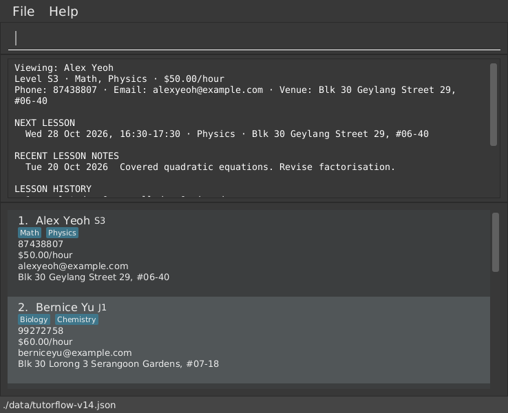

# TutorFlow User Guide

TutorFlow is a **desktop application that keeps your students and lessons in one place, optimized for use through a Command Line Interface (CLI)** while retaining the benefits of a Graphical User Interface (GUI).
For power-users, TutorFlow can help you manage your students and lessons faster than traditional GUI applications.

<!-- * Table of Contents -->
<page-nav-print />

--------------------------------------------------------------------------------------------------------------------

## Quick start

1. Ensure that Java `25` or later is installed on your computer.<br>
   **Mac users:** Ensure you have the precise JDK version prescribed [here](https://se-education.org/guides/tutorials/javaInstallationMac.html).

1. Download the latest `.jar` file from [the TutorFlow releases page](https://github.com/AY2627S1-CS2103T-F15-1/tp/releases/latest).

1. Copy the file to the folder you want to use as the _home folder_ for TutorFlow.

1. Open a terminal, `cd` to the folder containing the JAR file, and run `java -jar tutorflow.jar`.<br>
   A GUI similar to the one below should appear in a few seconds. A new dataset starts empty, and the screenshot below shows a list that already contains students. Type `demo` to preview optional sample records, then `demo confirm` to load them.<br>
   

1. Type a command in the command box and press Enter to execute it. For example, type **`help`** and press Enter to see the list of commands.<br>
   Some example commands you can try:

   * `list` : Lists your active students.

   * `add n/John Doe p/98765432 l/S4 s/Math r/50` : Adds a student named `John Doe`, who is in Secondary 4, learns Math and pays $50 per hour.

   * `delete 3` : Deletes the 3rd student shown in the current list.

   * `clear confirm` : Deletes all your data: students, lessons, homework, tasks and financial history.

   * `exit` : Exits the app.

1. Refer to the [Features](#features) section below for details of each command.

--------------------------------------------------------------------------------------------------------------------

## Features

<box type="info" seamless>

**Notes about the command format:**<br>

* Words in `UPPER_CASE` are the parameters to be supplied by the user.<br>
  For example, in `add n/NAME`, replace `NAME` with a value such as `John Doe`.

* Items in square brackets are optional.<br>
  For example, `n/NAME [e/EMAIL]` can be used as `n/John Doe e/john@example.com` or as `n/John Doe`.

* Items followed by `...` can appear zero or more times.<br>
  For example, `s/SUBJECT...` can be written as `s/Math` or `s/Math s/Physics`.

* Items such as `week/` and `all/` are flags: write them on their own, without a value.<br>
  For example, `agenda week/` is accepted, but `agenda week/yes` is rejected.

* Parameters can be in any order.<br>
  For example, if the command specifies `n/NAME p/PHONE_NUMBER`, `p/PHONE_NUMBER n/NAME` is also acceptable.

* `a|b` means one of the alternatives.<br>
  For example, `sort [asc|desc]` can be written as `sort asc` or `sort desc`.

* `confirm` is a literal word, written in lower case at the end of a command. It approves an action that would otherwise only be previewed, such as `delete 3 confirm`.

* Commands refer to a record by the number shown beside it. See [Using the numbers on screen](#using-the-numbers-on-screen).

* `today` and `exit` take no parameters. If you type anything after them, TutorFlow shows an error and does not run them.<br>
  For example, `exit now` is rejected, so a mistyped command cannot close the app.

* If you enter an unknown command, such as `foo`, TutorFlow shows `Unknown command. Type "help" for list of commands.` Type `help` to see the available commands.

* If you are using a PDF version of this document, be careful when copying and pasting commands that span multiple lines as space characters surrounding line-breaks may be omitted when copied over to the application.
</box>

### Viewing help: `help`

Shows every command, or how to use one command, without leaving TutorFlow.

Format: `help [COMMAND]`

* `help` shows every command with a one-line summary.
* `help COMMAND` shows what the command does, its parameters and an example. `COMMAND` is the command as you type it, so for the lesson commands write both words, such as `help lesson add`.
* `help lesson` lists the commands that start with `lesson`.
* `COMMAND` is case-sensitive, like every command. For a name that is not a command, such as `help foo`, TutorFlow says `No help available for 'foo'. Type 'help' for the full list.`
* To read this guide inside TutorFlow, use the `Help` menu or press `F1`. The guide opens in a resizable window and works offline. Use its Contents links to jump to any feature. External links are disabled inside the offline viewer, which shows a message when you activate one. It shows the User Guide bundled with your version of the app. Click `Reload guide` to return to that bundled guide.
* The command list and `help COMMAND` are short syntax references. The full guide includes the field limits, examples and behavior rules.
* Documentation changes appear in the next build of the app. When running from source, restart with `./gradlew run` (Windows: `.\gradlew.bat run`) to bundle the current `docs/UserGuide.md`. For a JAR, rebuild with `./gradlew shadowJar` or download an updated release, then restart with that JAR. `Reload guide` does not download newer documentation into an older JAR.

Examples:
* `help` lists all commands.
* `help lesson move` shows how to reschedule a lesson.

### Using the numbers on screen

Commands refer to a record by the number shown beside it, and each kind of number belongs to the list that last displayed it.

* **Student numbers** come from the student list in the main window. They change whenever the list changes, for example after `list`, `find`, `sort`, an addition or a deletion.
* **Lesson numbers** come from the last `agenda` or `lesson list`, in time order. When a command adds, moves, renames or removes a lesson so that the numbers of the lessons on screen shift, the result ends with `Lesson numbers have changed. Current lesson list:` and the new numbering. Use those numbers from then on. The same note appears in a save-error message if the change was made but could not be saved. A command that leaves every lesson where it was, such as marking a lesson done from the agenda, does not print it.
* **Homework, payment and task numbers** stay fixed until you run `hw list`, `pay list` or `task list` again. Adding, editing, changing a status, archiving, renaming a student and a failed save do not shift them. A number whose record was deleted says so, and never points at the next item.
* All of these numbers are for the current session. After TutorFlow restarts, display a list again before you use a number.

### Adding a student: `add`

Adds a student to TutorFlow.

Format: `add n/NAME p/PHONE_NUMBER l/LEVEL s/SUBJECT... r/RATE [e/EMAIL] [v/VENUE]`

* `NAME` is 1-100 printable characters after trimming and must contain at least one letter. It may contain letters in any language (such as `José Álvarez` or `陈伟明`), digits, spaces and `. , ' ( ) / - @`, such as `Tan Wei Ming (twin A)`, `Priya d/o Kumar` or `John @ Tan`. It does not matter how an accent is typed, so `José` written with one character and with a letter and a separate accent is the same name. Avoid typing a `/` right after a space when it would look like a prefix, such as `s/o`, because TutorFlow reads it as the start of the next parameter.
* `LEVEL` is one of `P1` to `P6` (primary), `S1` to `S5` (secondary) or `J1` to `J2` (junior college). It is not case-sensitive, so `s3` is the same as `S3`.
* `PHONE_NUMBER` has 8 to 15 digits and can start with `+`, for example `91234567` or `+6591234567`. Spaces and hyphens between the digits are allowed and are removed, so `9123 4567` is stored as `91234567`.
* `SUBJECT` is free text of up to 30 letters in any language, digits, spaces, `&` and `-`, such as `Math`, `English & Literature` or `华文`. Subjects are not case-sensitive.
* `RATE` is the amount charged per hour in SGD, from `0` to `9999.99` with at most 2 decimal places. A leading `$` is accepted, so `50`, `50.00` and `$50` are the same rate.
* `VENUE` is where the student is usually taught, up to 100 characters.
* Extra spaces in a `NAME` are ignored, so `John  Tan` is stored as `John Tan`.
* A student can have at most 10 different subjects, so a command with more than 10 `s/SUBJECT` values is rejected. The same limit applies when you [edit](#editing-a-student-edit) a student.
* Two students are duplicates if they have the same phone number and a name that matches when letter case and extra spaces are ignored. A duplicate is not added.
* Two different students can share a name, for example two students called `Tan Wei Ming` with different phone numbers. TutorFlow adds the student and shows a note, so that you can spot a double entry.

<box type="tip" seamless>

**Tip:** A student must have between 1 and 10 subjects. The email and the venue are optional.
</box>

Examples:
* `add n/John Doe p/98765432 l/S4 s/Math r/50`
* `add n/Betsy Crowe p/1234567 l/J1 s/Physics s/Chemistry r/62.50 e/betsycrowe@example.com v/Blk 123 Bishan St 13`

### Listing students: `list`

Shows your students and numbers them again, so that the other commands can refer to them.

Format: `list [l/LEVEL] [s/SUBJECT] [archived/|all/]`

* With no options, `list` shows your active students and says `Listed active students.`
* `l/LEVEL` and `s/SUBJECT` narrow the list. Given together they are combined with AND, so `list l/S3 s/Math` shows the S3 students who take Math. Both follow the same rules as for [`add`](#adding-a-student-add).
* `archived/` shows only archived students, and `all/` shows both. They are flags, so write them without a value, and do not use both together.
* With any option, the result says `Listed N matching student(s).` A filter that matches nobody is not an error: the list is empty and N is 0.
* Extra words, and a value written after `archived/` or `all/`, are rejected with the usage of the command, so a mistyped option never lists the wrong students.

Examples:
* `list` shows your active students.
* `list l/S3 s/Math` shows the active S3 students who take Math.
* `list archived/` shows the students you have archived.
* `list all/` shows every student.

### Editing a student: `edit`

Edits an existing student in TutorFlow.

Format: `edit INDEX [n/NAME] [p/PHONE_NUMBER] [e/EMAIL] [l/LEVEL] [s/SUBJECT]... [r/RATE] [v/VENUE]`

* Edits the student at the specified `INDEX`. The index refers to the index number shown in the displayed student list. The index **must be a positive integer** 1, 2, 3, ...
* At least one of the optional fields must be provided.
* Existing values will be updated to the input values.
* When editing subjects, all of the student's existing subjects are replaced; adding subjects is not cumulative. A student must keep at least one subject.
* Renaming a student or changing their phone number keeps their lessons, homework, payments and tasks attached to them. If the new name changes the order of the lessons on screen, the result shows the current lesson list, as described in [Using the numbers on screen](#using-the-numbers-on-screen).
* If the level changes, the result adds `Past lessons keep their original details.` Lessons booked earlier keep the level that the student had when they were booked.
* The values for the level, subjects, rate and venue follow the same rules as for [`add`](#adding-a-student-add).
* If the edit gives the student the name of another student, it is accepted and TutorFlow shows a note. If the phone number is also the same as that student's, the edit is rejected as a duplicate.

Examples:
*  `edit 1 p/91234567 e/johndoe@example.com` Edits the phone number and email address of the 1st student to be `91234567` and `johndoe@example.com` respectively.
*  `edit 2 l/S4 s/Math s/Chemistry` Changes the 2nd student to Secondary 4, and the subjects to `Math` and `Chemistry`.

### Locating students by name: `find`

Finds students whose names contain any of the given keywords.

Format: `find KEYWORD [MORE_KEYWORDS]`

* The search is case-insensitive; for example, `hans` matches `Hans`.
* Keyword order does not matter; for example, `Hans Bo` matches `Bo Hans`.
* The search considers only names.
* A keyword matches any part of a name; for example, `Han` matches `Hans` and `Johan`, and `wei` matches `Tan Wei Ming`.
* A keyword can be up to 100 characters long.
* Students matching at least one keyword are returned (an `OR` search); for example, `Hans Bo` returns `Hans Gruber` and `Bo Yang`.

Examples:
* `find John` returns `john` and `John Doe`
* `find alex david` lists `Alex Yeoh` and `David Li` if those students are recorded. If only those two students match, the result says `2 student(s) listed!` and the student list shows their current details with new index numbers.

### Viewing a student's overview: `view`

Shows what you need to prepare for one student, on one screen.

Format: `view INDEX`

* Shows the student at the specified `INDEX`.
* The index refers to the index number shown in the displayed student list.
* The index **must be a positive integer** 1, 2, 3, ...
* The overview shows, in this order:
  * the student's level, subjects, rate, phone number and, if recorded, email, usual venue and remark
  * the **next lesson**: the date, time, subject and venue of the first scheduled lesson from today onwards
  * the **recent lesson notes**: the notes of the 3 most recent completed lessons, newest first
  * the **lesson history**: how many lessons are completed, cancelled and missed
  * the **balance**: outstanding amount or credit from charges, payments, and reversals
  * the **outstanding homework**: assignments awaiting submission or review, with due dates and feedback
* A section with nothing to show says so, for example `No upcoming lessons.`, instead of disappearing.
* The command only shows information. It does not change the student list, so the indexes you use for other commands stay the same.

Examples:
* `list` followed by `view 2` shows the overview of the 2nd student.
* `find Betsy` followed by `view 1` shows the overview of the 1st student in the results of the `find` command.

### Adding a remark to a student: `remark`

Sets a free-text remark on a student, such as a preference or something to remember.

Format: `remark INDEX r/REMARK`

* Sets the remark of the student at the specified `INDEX`, which is the index number shown in the displayed student list and **must be a positive integer** 1, 2, 3, ...
* The new remark replaces the old one. Writing `r/` with nothing after it removes the remark.
* A remark is shown in the student's card and in [`view`](#viewing-a-students-overview-view).

Examples:
* `remark 1 r/Prefers morning lessons` sets the remark of the 1st student.
* `remark 1 r/` removes the remark of the 1st student.

### Sorting students by name: `sort`

Sorts all students by name, ignoring upper and lower case.

Format: `sort [asc|desc]`

* `asc` sorts from A to Z and `desc` sorts from Z to A. If no order is given, `asc` is used.
* After sorting, the list shows your active students, even if it was filtered by an earlier `find` command. Archived students are sorted too, and appear with `list archived/` or `list all/`.
* The new order is saved, so the students stay in this order the next time you open the app.

Examples:
* `sort` sorts all students from A to Z.
* `sort desc` sorts all students from Z to A.

### Archiving and restoring a student: `archive`, `restore`

Takes a student who has stopped lessons out of your active list, while their lessons, homework, payments and tasks stay available.

Format: `archive INDEX` and `restore INDEX`

* `INDEX` is the number shown in the displayed student list. To restore a student, type `list archived/` first, so that the archived students are numbered.
* An archived student keeps all their records. Upcoming lessons stay in the agenda, so that no commitment is silently dropped, and any money they owe stays in `dues` and in their account. Archiving never forgives or hides a debt.
* Homework status and feedback, and payments and their reversals, can still be recorded for an archived student.
* New work is refused, so that a student is never half-active. Scheduling a lesson or a series gives `Restore this archived student before scheduling a new lesson.` and assigning homework gives `Restore this student before assigning new homework.`
* `archive` on a student who is already archived says so. `restore` on a student who is already active says `This student is already active. Use student list archived/ before restoring.`

Examples:
* `archive 3` archives the 3rd student in the displayed list.
* `list archived/` followed by `restore 1` restores the 1st archived student.

### Deleting a student: `delete`

Deletes the specified student from TutorFlow.

Format: `delete INDEX [confirm]`

* Deletes the student at the specified `INDEX`.
* The index refers to the index number shown in the displayed student list.
* The index **must be a positive integer** 1, 2, 3, ...
* A student with no lessons, homework, tasks, or financial history is deleted immediately.
* Deleting a student also deletes **all of their lessons, homework, and financial history**, including feedback. Type [`undo`](#undoing-a-deletion-undo) straight afterwards to bring everything back. If the student has linked records, TutorFlow shows their name, phone number, linked counts, and upcoming commitments, and asks you to repeat the command with `confirm`.
* The keyword `confirm` is in lower case.
* The preview has the same shape for every student. A student who has only lessons gets the first three lines of the example below. A student who also has homework, payments or tasks gets the last two lines as well: the counts of what would be deleted (tasks are counted when there are any), their balance, and the advice to use `archive` to keep the history. If any homework has feedback, the preview also says how many items.

Examples:
* `list` followed by `delete 2` deletes the 2nd student, if they have no lessons, homework, tasks, or financial history.
* `delete 2` on a student with only payment history still shows a confirmation prompt, including their balance. Use `archive 2` to retain that history, or `delete 2 confirm` to delete it.
* `delete 3` on a student with 12 lessons shows a prompt; `delete 3 confirm` then deletes the student and the 12 lessons.
* `find Betsy` followed by `delete 1` selects the 1st student in the results for deletion; linked history still requires `confirm`.

Example of a preview, for a student with 6 lessons and 1 payment:
```
> delete 1
Tan Wei Ming (phone: 91234567) has 6 lesson(s). These will all be deleted.
Warning: this student has 4 upcoming lesson(s).
Type 'delete 1 confirm' to proceed.
This also deletes 0 homework item(s), including 0 upcoming homework item(s), and 1 financial event(s).
Balance: OUTSTANDING $60.00. Use 'archive INDEX' to retain these obligations and all history instead.
```

### Writing student commands with `student`

Every student command can be typed with or without the word `student`, so `add n/John Doe ...` and `student add n/John Doe ...` are the same command.

Format: `student add|edit|delete|find|view|list|archive|restore ...` (the same arguments as the command without `student`)

* Typing `student` on its own, or with any other word, lists these sub-commands.

Example:
* `student find James` does the same as `find James`.

### Scheduling a lesson: `lesson add`

Schedules a lesson for a student.

Format: `lesson add st/STUDENT_INDEX [s/SUBJECT] d/DATE t/TIME [dur/MINUTES] [v/VENUE] [past/]`

* `STUDENT_INDEX` is the index number shown in the displayed student list, and **must be a positive integer** 1, 2, 3, ...
* `DATE` is written as `YYYY-MM-DD`, such as `2026-12-22`, or as `DD/MM/YYYY`, such as `22/12/2026`, or as the word `today` or `tmr` (tomorrow), which is not case-sensitive. The same forms work in `agenda d/DATE` and `lesson move d/DATE`. It must be today or later, and no more than 2 years ahead, which catches a mistyped year.
* `TIME` is written in 24-hour time, such as `16:30`. `4:30pm` and `1630` are also accepted.
* `MINUTES` is the length of the lesson, from `15` to `480` in steps of `15`. If it is left out, it is `60`.
* `SUBJECT` must be one of the student's subjects, and is not case-sensitive. If the student has only one subject, it can be left out. If the student has several, it must be given.
* `VENUE` is up to 100 characters. If it is left out, the student's usual venue is used, or `—` if the student has none.
* `past/` takes no value. A date before today is rejected unless you add it, which records a lesson that has already taken place, for example one you forgot to enter. The date may then be up to 2 years in the past; every other rule still applies. Complete the lesson afterwards with [`lesson done`](#completing-a-lesson-and-recording-notes-lesson-done).
* A lesson must end on the day it starts, so `t/23:00 dur/120` is rejected. Split it into two lessons.
* Two lessons are duplicates if they have the same student, subject, date, time and duration. A duplicate is rejected.
* The lesson records the student's level at the time of booking. Changing the student's level later does not change it.
* An archived student cannot be given a new lesson. Restore them first with [`restore`](#archiving-and-restoring-a-student-archive-restore).
* Adding a lesson keeps the current day, week or student lesson filter. If the new lesson shifts existing lesson numbers, the result shows the complete current lesson list with fresh numbers. Use those numbers for your next lesson command.

<box type="warning" seamless>

**Overlaps and travel only warn:** if the new lesson overlaps another scheduled lesson by at least one minute on the same date, it is still scheduled and the result lists the lessons it overlaps with. Lessons that end exactly when the next one starts do not overlap. Cancelled lessons are ignored. A lesson that leaves too little time to travel from a lesson at a different venue also only warns; see [Warnings about travel between venues](#warnings-about-travel-between-venues-travel).
</box>

Examples:
* `lesson add st/1 s/Math d/2026-12-22 t/16:30 dur/90` Schedules a 90-minute Math lesson for the 1st student at the student's usual venue.
* `lesson add st/2 d/2026-12-23 t/19:00 v/Online` Schedules a 60-minute lesson online for the 2nd student, in the only subject that student takes.
* `lesson add st/1 s/Math d/tmr t/16:30` Schedules a Math lesson for the 1st student tomorrow.
* `lesson add st/1 s/Math d/2026-10-12 t/16:30 past/` Records a Math lesson on 12 October that has already happened.

### Scheduling a weekly series: `lesson repeat`

Books the regular weekly lessons of a student in one command.

Format: `lesson repeat st/STUDENT_INDEX [s/SUBJECT] d/START t/TIME [dur/MINUTES] [v/VENUE] count/COUNT [every/WEEKS]`

* The subject, time, duration and venue follow the same rules and defaults as for [`lesson add`](#scheduling-a-lesson-lesson-add). `past/` is not accepted.
* `COUNT` is the number of lessons, from 2 to 52. `WEEKS` is the gap between lessons in weeks, from 1 to 12, and is 1 if it is left out. The last lesson must be within 2 years of today.
* The first lesson is on the `START` date. Each later one is at the same time of day, `WEEKS` weeks after the one before.
* The batch is all or nothing. If any lesson is a duplicate of an existing lesson, or is invalid, none is added. Overlap and travel warnings do not block it. They are listed, and summarised when there are many.
* Every lesson of the series is a normal lesson that can be moved, cancelled, completed and charged on its own. Moving or cancelling one keeps it in the series.
* The result says `Scheduled 4 weekly occurrences.`, or `Scheduled 3 occurrences, every 2 weeks.` for a gap of more than one week. If the new lessons are in the lesson list on screen, the result shows that list with fresh numbers. Otherwise it says so, and `agenda` or `lesson list st/STUDENT_INDEX` numbers them.

Examples:
* `lesson repeat st/1 d/tmr t/16:00 count/8` books eight weekly lessons for the 1st student, starting tomorrow.
* `lesson repeat st/1 d/tmr t/17:00 dur/90 count/10 every/2` books ten lessons, two weeks apart.

### Viewing the agenda: `agenda`

Shows the lessons of a day or of a week, in the order that they take place.

Format: `agenda [d/DATE] [week/]`

* Without `d/DATE`, it shows today. `DATE` is written as for [`lesson add`](#scheduling-a-lesson-lesson-add).
* With `week/`, it shows the Monday to Sunday week that contains the date, one day after another. A day without lessons shows `— no lessons —`.
* Each line shows the lesson number, the time, the student, the subject, the venue, and the status if the lesson is not simply scheduled. Lessons that overlap another lesson are marked `⚠ overlaps`.
* Cancelled lessons are listed but are not counted in the number of lessons and the total time.
* The lesson numbers are the ones that `lesson move`, `lesson cancel`, `lesson done`, `lesson missed` and `lesson prep` take, so run `agenda` or `lesson list` first and then use the number you see.
* Lessons are numbered in time order, so moving a lesson to another time can change its number, and the numbers of others. Run `agenda` or `lesson list` again before you use a number a second time. The result of `lesson move` and `lesson cancel` names the lesson that was changed, so you can check that it was the right one.
* A day without lessons is not an error: it shows `No lessons on Tue 22 Dec 2026.`

Examples:
* `agenda` Shows today's lessons.
* `agenda d/2026-12-22 week/` Shows the week of Monday 21 December 2026.

### Viewing today's dashboard: `today`

Shows what today requires: today's lessons, past lessons not yet marked completed, overdue homework, and outstanding balances. TutorFlow also shows this when it starts.

Format: `today`

* The first section, `TODAY'S LESSONS`, shows the number of lessons today and their total time, followed by the time, student, subject and venue of each lesson. Lessons that overlap another lesson are marked `⚠ overlaps`. Cancelled lessons are left out.
* The second section, `LESSONS AWAITING NOTES`, shows the scheduled lessons from earlier days that were not marked completed, the most recent first.
* The third section, `OVERDUE HOMEWORK`, shows assigned work due before today, or `No overdue homework.`. Run `hw list overdue/` to get selectable numbers.
* The fourth section, `DUES`, shows positive balances ordered by the age of the oldest unpaid charge.
* An empty section is not an error: it shows `No lessons today.` or `All past lessons are recorded.`
* Today is the date on your computer, so a wrong system clock shows the wrong day.

Examples:
* `today` on Thursday 17 September 2026 might show:
  ```
  Thursday, 17 September 2026

  TODAY'S LESSONS (2, 2h 30m)
    16:30-18:00  Tan Wei Ming       Math       Blk 512 Bishan St 13  ⚠ overlaps
    17:00-18:00  Priya d/o Kumar    Physics    Online  ⚠ overlaps

  LESSONS AWAITING NOTES (1)
    Tue 15 Sep  Lim Jia Hui        Science    not yet marked completed
  ```

### Listing the lessons of a student: `lesson list`

Shows the lessons of one student.

Format: `lesson list st/STUDENT_INDEX [all/]`

* `STUDENT_INDEX` is the index number shown in the displayed student list.
* By default, only upcoming lessons are shown, which means scheduled lessons from today onwards. With `all/`, past, completed, cancelled and missed lessons are shown as well.
* The lessons are numbered in date order. These are the numbers that `lesson move`, `lesson cancel`, `lesson done`, `lesson missed` and `lesson prep` take.
* Each lesson shows the level that the student had when it was booked, such as `Level at booking: S3`, and the preparation recorded for it, if any. Lessons booked before this version show `Level at booking: unknown (not recorded)`, because that level cannot be worked out afterwards.
* A student with no lessons gets `Tan Wei Ming has no lessons.`

Examples:
* `lesson list st/1` Shows the upcoming lessons of the 1st student.
* `lesson list st/1 all/` Shows every lesson of the 1st student.

### Rescheduling a lesson: `lesson move`

Moves a lesson to another date, time, duration or venue, and keeps everything else.

Format: `lesson move INDEX [d/DATE] [t/TIME] [dur/MINUTES] [v/VENUE]`

* `INDEX` is the lesson number in the list that is currently shown by `agenda` or `lesson list`, and **must be a positive integer** 1, 2, 3, ...
* At least one of the optional fields must be given. Fields that are not given stay as they were.
* The values follow the same rules as for [`lesson add`](#scheduling-a-lesson-lesson-add). A new date must be today or later. Only a date that you give is checked, so you can still change the time of a lesson that has already passed.
* A completed, cancelled or missed lesson cannot be rescheduled. Moving a missed lesson would lose the record that it was missed, so schedule a make-up lesson with [`lesson add`](#scheduling-a-lesson-lesson-add) instead.
* If the move makes the lesson identical to another lesson, it is rejected. If it makes the lesson overlap another lesson, it is moved and the result warns you.

Examples:
* `lesson move 1 d/2026-12-24` Moves the 1st lesson to 24 December 2026 at the same time.
* `lesson move 2 t/17:00 v/Online` Moves the 2nd lesson to 17:00 and changes its venue to `Online`.

### Cancelling a lesson: `lesson cancel`

Cancels a lesson but keeps its record, so that you can still see that the slot was booked.

Format: `lesson cancel INDEX [r/REASON]`

* `INDEX` is the lesson number in the list that is currently shown by `agenda` or `lesson list`.
* `REASON` is up to 200 characters on one line, such as `Student unwell`.
* The lesson stays in the agenda as cancelled and no longer overlaps other lessons.
* A lesson that is already cancelled or already completed cannot be cancelled.
* A cancelled lesson does not block its slot. To book that time again, use `lesson add` with the same details. The cancelled record stays in your history.

Examples:
* `lesson cancel 1` Cancels the 1st lesson.
* `lesson cancel 3 r/Student unwell` Cancels the 3rd lesson and records the reason.

### Cancelling a weekly series: `lesson series cancel`

Ends a weekly series from now on, without cancelling each lesson by hand.

Format: `lesson series cancel LESSON_INDEX confirm`

* `LESSON_INDEX` is the number, in the lesson list on screen, of any lesson of the series. `confirm` is required. Without it, TutorFlow shows the usage and cancels nothing.
* Every scheduled lesson of the series that starts now or later is cancelled, including lessons that were moved. Earlier lessons, and anything completed, missed or already cancelled, stay as they were, so the history is kept. Each cancelled lesson records the reason `Series cancelled`.
* The command is all or nothing. If an affected lesson has an active charge, nothing is cancelled until that charge is reversed with `charge reverse l/LESSON_INDEX`.
* A lesson that is not part of a series gives `That lesson is not part of a recurring series.` A series with nothing left to cancel gives `This series has no scheduled occurrences starting now or later.`

Example:
* `lesson series cancel 3 confirm` cancels the series that the 3rd lesson belongs to, from now on.

### Completing a lesson and recording notes: `lesson done`

Marks a lesson completed and optionally records what was taught.

Format: `lesson done INDEX [n/NOTES]`

* `INDEX` is the lesson number from the current `agenda` or `lesson list`, not the student number. It must be a positive integer.
* Only lessons dated today or earlier can be completed, using your computer's local date. A cancelled lesson cannot be completed.
* `NOTES` is optional free text of 1–1000 printable characters on one line. Leading/trailing whitespace is trimmed and repeated spaces are collapsed. An empty `n/`, line breaks and repeated `n/` parameters are rejected.
* First completion also records a charge at the current hourly rate unless the amount rounds to zero. Charge corrections use `charge reverse`; see [Charges, payments, and accounts](#charges-payments-and-accounts).
* Completing a lesson retains its student, subject, date, time, duration and venue. The status and notes are saved automatically. Use `view STUDENT_INDEX` to see recent notes and the completed-lesson count.
* Repeating the command with `n/NOTES` updates the notes on the same completed lesson. Omitting `n/` retains existing notes. A lesson previously marked missed can also be changed to completed.
* A completed lesson disappears from an upcoming-only `lesson list`. Use `lesson list st/STUDENT_INDEX all/` to include it again; check the current lesson number before updating notes.
* A space followed by `n/` starts a note parameter, so it cannot also appear literally inside the note text.

Examples:
* `agenda` followed by `lesson done 1` completes today's 1st lesson without adding notes.
* `lesson list st/1 all/` followed by `lesson done 2 n/Covered quadratic roots. Revise factorisation.` completes the 2nd displayed lesson or updates its notes if already completed.

### Recording a missed lesson: `lesson missed`

Marks a scheduled lesson as missed without deleting its record.

Format: `lesson missed INDEX`

* `INDEX` is the positive lesson number from the current `agenda` or `lesson list`, not the student number. Use `lesson list st/STUDENT_INDEX all/` to select a past lesson.
* Only lessons dated today or earlier can be marked missed, using your computer's local date. Future, cancelled and completed lessons are rejected without changing data.
* The student, subject, date, time, duration, venue and existing notes are retained. The missed status is saved automatically and counted in `view STUDENT_INDEX` under lesson history.
* A missed lesson disappears from an upcoming-only list and no longer counts as a scheduling overlap. Use `all/` to include it again and check its current lesson number.
* Repeating `lesson missed` on the same missed lesson leaves it unchanged. If the lesson actually took place, use `lesson done INDEX [n/NOTES]` to correct it to completed.
* No extra parameters are accepted. This command does not record fees or payments.

Examples:
* `agenda` followed by `lesson missed 1` marks today's 1st displayed lesson as missed.
* `lesson list st/1 all/` followed by `lesson missed 2` marks the 2nd displayed lesson as missed, provided it is scheduled for today or earlier.

### Recording preparation notes: `lesson prep`

Notes what to prepare for a lesson, kept apart from the notes written after the lesson.

Format: `lesson prep INDEX n/NOTES`

* `INDEX` is the lesson number from the current `agenda` or `lesson list`. `NOTES` is 1-1000 printable characters on one line.
* Preparation does not complete the lesson and does not change its teaching notes. It appears in `lesson list` and in the next-lesson section of [`view`](#viewing-a-students-overview-view).
* Running the command again on the same lesson replaces the earlier preparation.

Example:
* `agenda` followed by `lesson prep 1 n/Bring the mock paper` records the preparation for the 1st lesson.

### Warnings about travel between venues: `travel`

Sets how much time TutorFlow expects you to need between two lessons at different places. The warnings work offline.

Format: `travel buffer/MINUTES`

* `MINUTES` is from 0 to 180. The default is 30, and the setting survives a restart. [`clear confirm`](#clearing-all-entries-clear) sets it back to 30.
* `lesson add`, `lesson repeat`, `lesson move`, `agenda` and `today` warn when consecutive scheduled lessons at different physical venues leave less time than this buffer. The warning shows the available and the required minutes.
* Venues that are equal, ignoring case, do not trigger a warning. Neither do lessons with no venue or `Online` lessons. Overlap warnings stay separate.
* These are reminders, not route estimates, and never block a booking.

Examples:
* `travel buffer/45` sets the buffer to 45 minutes.
* `travel buffer/200` is rejected, because the buffer is at most 180 minutes.

### Tracking homework: `hw`

Tracks what you set, what came back and who needs chasing. Each homework item has a student, a description, a due date, a status (`assigned`, `submitted` or `reviewed`) and optional feedback.

Use `hw list` before an indexed homework command. The numbers belong to that list until you run `hw list` again; see [Using the numbers on screen](#using-the-numbers-on-screen).

| Action | Command |
|---|---|
| Assign | `hw add st/STUDENT_INDEX desc/DESCRIPTION due/DATE` |
| List all history | `hw list [st/STUDENT_INDEX]` |
| Find unsubmitted past-due work | `hw list [st/STUDENT_INDEX] overdue/` |
| Find work awaiting submission or review | `hw list [st/STUDENT_INDEX] outstanding/` |
| Correct description or due date | `hw edit INDEX [desc/DESCRIPTION] [due/DATE]` |
| Update lifecycle | `hw status INDEX s/assigned`, `s/submitted`, or `s/reviewed` |
| Record or replace feedback | `hw feedback INDEX f/FEEDBACK` |
| Delete | `hw delete INDEX [confirm]` |

* Descriptions contain 1-200 printable characters on one line. Feedback contains 1-1000.
  Surrounding spaces are trimmed and repeated spaces are collapsed. Empty values and duplicate
  prefixes are rejected. Free text may contain unrelated prefix-like words, such as `n/`.
* Due dates accept `YYYY-MM-DD`, `DD/MM/YYYY`, `today`, or `tmr`. Assignment dates and changed due
  dates must be today through one calendar year ahead, inclusive, using the local computer date.
  Editing another field preserves an old due date; explicitly supplying the same old date also works.
* Identical normalized descriptions and due dates for the same student are rejected, even when
  the earlier item is reviewed. In-place edits preserve identity, status, and existing feedback.
* New homework starts `assigned`. Status values are case-insensitive. `overdue` is derived only
  when assigned homework has a due date before today; submission clears it. Repeating the same
  status reports that it is already set. Backward corrections are allowed with a warning and retain
  recorded feedback. Recording new feedback requires `submitted` or `reviewed`.
* Lists show overdue items first, then due dates ascending, retaining insertion order for ties.
  History includes reviewed items and feedback; `outstanding/` includes assigned and submitted work.
  `overdue/` and `outstanding/` take no values and cannot be combined.
* Homework may be assigned without an upcoming lesson; the result includes a note. Archived
  students retain homework and can receive status/feedback corrections. Restore them before assigning
  new work. Use `student list archived/` then `hw list st/INDEX` to inspect their full history.
* `view INDEX` includes outstanding homework; `today` and the startup dashboard include overdue
  homework. These summaries do not change the numbered homework selection.
* Homework deletion requires `confirm` when feedback exists. Student deletion reports linked
  homework and upcoming outstanding homework counts and requires confirmation. Confirmed student
  deletion removes its homework and feedback; `clear confirm` removes all homework as well.
* A failed save retains the change and the same numbered selection in this session. Fix the write
  problem and use `save` before closing; the normal exit flow refuses to discard unsaved work.

Example journey: `hw add st/1 desc/Algebra Q1-10 due/tmr`, `hw list`,
`hw status 1 s/submitted`, `hw feedback 1 f/Revisit sign errors`, `hw status 1 s/reviewed`,
then `hw list st/1` to inspect the completed history.

### Charges, payments, and accounts

All money is SGD. Rates are per hour. On first completion, `lesson done INDEX` records one
charge using the student's current rate multiplied by the lesson's duration divided by 60,
rounded once to cents using HALF_UP. For example, $70.01/hour for 90 minutes is $105.02.
The original rate, duration, amount, and subject description are retained. Editing the student
rate or correcting completion notes never changes or adds another charge. A charge that has
been reversed is never automatically restored by `lesson done`.

If a rate is zero, or the computed amount rounds to zero, completion still records the outcome
and explains why no automatic charge was raised. Use an explicit positive override if agreed.
Missed lessons are charged only when you explicitly use `charge`.

| Command | Purpose |
| --- | --- |
| `charge l/LESSON_INDEX [amt/AMOUNT]` | Record a charge at the current rate, or an agreed amount |
| `charge reverse l/LESSON_INDEX` | Reverse the lesson's active charge |
| `pay st/STUDENT_INDEX amt/AMOUNT [d/DATE] [n/NOTES]` | Record money received; date defaults to today |
| `pay list [st/STUDENT_INDEX]` | Display numbered payments, including reversed history |
| `pay reverse PAYMENT_INDEX` | Reverse a payment from the last displayed payment list |
| `balance st/STUDENT_INDEX` | Show the complete account and running balance |
| `dues` | List positive debts by age of the oldest unpaid charge |

* `AMOUNT` must be greater than zero with at most two decimal places. An optional leading `$`
  is accepted; negatives, scientific notation, and thousands separators are rejected.
* Charges are allowed for past or today's scheduled, completed, and missed lessons. A cancelled
  or future lesson cannot be charged. Each lesson may have only one active charge. To correct
  an agreed amount, reverse it first and then record a replacement with `amt/`.
* A booking with an active charge cannot be cancelled or rescheduled. Reverse its charge first;
  the original charge and reversal stay in history. Rescheduling never rewrites past amounts.
* Payment dates cannot be in the future. Existing date formats, `today`, and `tmr` are understood
  (`tmr` is rejected as a payment date). Optional notes must be 1–200 printable characters.
* Identical payments are accepted: two transfers for the same amount on the same date may be real.
  Use `pay reverse` to correct accidental duplication. A charge or payment cannot be reversed twice.
* Payments offset the oldest active charge first, including partially paid charges. Extra payments
  remain as credit and offset later charges. Reversing a charge or payment recomputes allocation;
  reversing an already paid charge can put the student into credit.
* `balance` interleaves dated charges, payments, and compensating reversal rows, without truncation.
  Same-day events keep their original recording order, including after restart. Charges use the
  lesson date; payments use the entered date; reversals use the date the reversal is recorded.
  Totals are net of reversals; credit is labelled `IN CREDIT` with a positive amount.
* `dues` includes active and archived students with a positive balance, oldest unpaid charge first.
  It excludes students with zero balance or credit. Ties are ordered by name, then stable identity.
  `view` includes the student's balance, and `today` includes the same dues summary.
* Only `pay list` changes payment numbering. Backdated additions, reversals, student renames, archive,
  and failed saves leave those shown rows bound to their original payments. Run `pay list` again to
  refresh. Accounts and dues are unnumbered summaries and do not change this selection. After restart,
  run `pay list` before `pay reverse`. A deleted payment produces an error rather than selecting another.
* Archived obligations remain usable: `student list archived/`, then `pay st/INDEX`,
  `balance st/INDEX`, or `pay list st/INDEX`. Archive retains all debts and credit.
* Student deletion requires confirmation when any financial history exists, even if fully paid or
  reversed. Its preview includes linked counts and the balance. Confirmed deletion removes all linked
  history; use archive to retain it. `clear confirm` also removes every financial event.

For example, record `charge l/1 amt/105`, then `pay st/1 amt/150 n/PayNow ref 4471`.
`balance st/1` shows $45.00 in credit. `pay list st/1` shows the payment's reversal index.
If it was entered by mistake, `pay reverse 1` appends a reversal and restores $105.00 outstanding.

Older files have an explicitly empty financial ledger. Previously completed lessons are **not**
retrospectively billed at today's profile rate, and correcting their notes does not bill them.
Use `charge l/INDEX amt/AGREED_AMOUNT` for a historical charge you have verified.
All financial changes use the existing atomic save and retry protection. If a save fails, the change
remains in the session and `save` retries it; do not re-enter a payment, as that creates a second transfer.

### Linked follow-up tasks: `task`

Keeps a to-do attached to the student, lesson, homework or payment that it is about, so that follow-ups are not forgotten.

Create a task with exactly one link:

* `task add st/1 desc/Call parent due/tmr`
* `task add lesson/2 desc/Prepare revision slides`
* `task add hw/1 desc/Check worksheet due/today`
* `task add pay/1 desc/Send receipt`

Student and lesson indices use the displayed student list and agenda. Run
`hw list` or `pay list` before linking their numbered rows. Task descriptions
are 1–200 printable characters; due dates are optional, accept `today` and
`tmr`, and may be historical (an open task then shows overdue). A word such
as `hw/2` or `pay/1` after a space inside a description is read as another
link, so reword the description if it needs one.

`task list [st/INDEX]` shows open tasks by due date, with undated tasks last.
`task list all/ [st/INDEX]` includes completed history. `task done INDEX`
completes a task. `task edit INDEX desc/TEXT [due/DATE]` retains its link and
completion state; omitting due/ retains the old date, while `due/-` removes it.
`task delete INDEX` previews deletion; repeat with `confirm` to delete.

Task indices keep referring to the exact last shown rows after additions,
due-date edits, completion, and deletion. A deleted row is rejected until
`task list` refreshes numbering. Restart requires a fresh list. The same
protection applies when linking last-shown homework and payment rows.

Archived students remain usable for follow-ups. Task lists show the linked
record's current identity, cancelled/completed lesson state, homework state,
and reversed-payment history. Payments always link to the original transfer.
Deleting a student deletes all their linked tasks, including tasks on lessons,
homework, and payments; the preview requires confirmation and offers archive.
Deleting homework with linked tasks also requires confirmation and cascades
those tasks. `clear confirm` deletes all tasks and resets the travel buffer.

### Clearing all entries: `clear`

Deletes **all** students, lessons, homework, tasks, and financial history from TutorFlow, and sets the travel buffer back to 30 minutes.

Format: `clear confirm`

* Typing `clear` on its own deletes nothing. It only reminds you what would be deleted and how to confirm.
* `confirm` must be written exactly in lower case. Anything else after `clear` is rejected, so a mistyped command can never wipe your data.
* [`undo`](#undoing-a-deletion-undo) brings everything back straight after a clear, but only until you change any data or close TutorFlow. TutorFlow saves the empty data straight away, so copy `data/tutorflow-v14.json` first if you may want your records back after closing.
* Clearing data that is already empty works and does nothing.

Examples:
* `clear` shows `This deletes ALL students, lessons, homework, tasks, and financial history. Type 'clear confirm' to proceed.`
* `clear confirm` deletes everything.

### Loading sample data: `demo`

Lets you try TutorFlow with sample students without typing them in.

Format: `demo [confirm]`

* `demo` on its own only says how many sample students it would load. `demo confirm` loads them and says `Sample students loaded.`
* It works only on an empty dataset, so sample data never replaces or mixes with your own records. Otherwise it says `Demo requires an empty dataset. Your records have been retained.`
* To remove the sample students, use [`clear confirm`](#clearing-all-entries-clear).

Examples:
* `demo` says what would be loaded.
* `demo confirm` loads the sample students.

### Undoing a deletion: `undo`

Restores all data as it was before your latest destructive command.

Format: `undo`

* `undo` takes no parameters.
* It reverses the most recent student deletion (`delete`), `clear confirm`, `hw delete` or `task delete` that changed your data.
* Everything returns together with its history. A deleted student comes back with their lessons, homework, payments, charges and tasks, and a cleared data set comes back with its travel buffer.
* Only one step is remembered, and only until you close TutorFlow. Any later change to your data, however small, discards it, so `undo` can never wipe out newer work. Looking things up (`list`, `find`, `view`, `agenda`, `today`, `help`, `hw list`, `pay list`, `task list`) and previews that ask for `confirm` do not.
* Undoing twice in a row is rejected, and there is no redo.
* If TutorFlow could not save a deletion, `undo` still works. If it cannot save the restored data, it keeps the restored data in the session and asks you to fix the problem and type `save`.
* Payments and charges are never deleted one by one. Correct them with `pay reverse` and `charge reverse`, which keep the history.

Example:
* `delete 2 confirm` followed by `undo` deletes the 2nd student and then restores them with all of their records.

### Exiting the program: `exit`

Exits the program.

Format: `exit`

### Saving the data

Format: `save`

TutorFlow automatically saves after a command changes data. `save` takes no parameters and retries a save that failed. If saving fails, fix the reported problem and use `save` to retry before closing. Read-only commands do not write the data file.

Each save is written completely to a temporary file beside the data file before replacing the previous save. If writing fails, the previous saved contents remain intact. If your file system cannot replace files atomically, TutorFlow reports a save error; move the app to a local folder that supports atomic file replacement and retry.

If a change cannot be saved, for example because the disk is full or the file is read-only, TutorFlow says `Your change was applied in this session but could not be saved`, and the reason. The change is still in the running app, so fix the problem (free some space, or make the file writable) and run `save` to retry saving. Read-only commands do not write the data file. Closing TutorFlow with `exit`, the window close button, or File > Exit retries saving and is refused if saving still fails, so that you do not lose the change.

Read-only commands do not routinely save. After a failed save, they display an unsaved-changes reminder. Run `save` after fixing the problem; a successful retry clears that reminder.

Only open one instance for a data file: concurrent instances use last-write-wins and can overwrite each other's changes.

Names, venues, reasons and notes must be printable text on one line; repeated spaces are collapsed. Email local parts may include `%`, the terminal domain label must contain at least two letters, and comparison ignores case.

Previously accepted names, short phone numbers, email terminal labels and venues remain readable through explicit legacy loading. Invalid subject counts (outside 1-10 distinct subjects) and invalid cancellation reasons reject the whole data file and use the recovery process below; individual records are never silently discarded.

### Editing the data file

TutorFlow data is saved automatically as a JSON file `data/tutorflow-v14.json` relative to the folder from which TutorFlow is launched. Advanced users are welcome to update data directly by editing that data file.

Every lesson and homework assignment must link to a student in the same file through its internal student ID. Legacy lessons are linked by name and phone during migration. Missing student links are treated as invalid, as described below.

<box type="warning" seamless>

**Caution:**
If your changes make the data file invalid, TutorFlow does not delete it. At the next run it renames the file to `tutorflow-v14.json.corrupt` (or `tutorflow-v14.json.corrupt.1` and so on, if that name is taken), starts with no students and lessons, and tells you where the file went. Fix the file and rename it back to `tutorflow-v14.json` while TutorFlow is closed to get your records back. We still recommend backing up the file before editing it.<br>
If the original cannot be renamed (for example, while another program holds it open), saving is blocked and retries preservation before replacing it. The original bytes are retained in the `.corrupt` copy once the lock clears.

Furthermore, certain edits can cause TutorFlow to behave in unexpected ways (e.g., if a value entered is outside of the acceptable range). Therefore, edit the data file only if you are confident that you can update it correctly.
</box>

### Upgrading from an older version

TutorFlow keeps your records when you upgrade. You do not need to convert or re-enter anything.

* This version saves its data in `data/tutorflow-v14.json`. If that file does not exist and an older `data/addressbook.json` does, TutorFlow reads the older file, gives every student and lesson a permanent identity, and saves a first copy as `data/tutorflow-v14.json`.
* The older file is left untouched, so an older version of TutorFlow can still open it. If both files exist, the newer file is used. Keep both in your backups.
* Every student and lesson is carried over. Lessons booked before this version show `unknown (not recorded)` as their level at booking, because that level cannot be worked out afterwards. Homework and the financial ledger start empty, and previously completed lessons are not billed retrospectively. Use `charge l/LESSON_INDEX amt/AGREED_AMOUNT` for a historical charge that you have verified.
* Earlier versions treated a student's rate as the price of one lesson. In this version a rate is the price of one hour, so a 90-minute lesson costs 1.5 times the rate. Migrated rates keep their numbers, so check them after upgrading.
* The new file appears only after a complete save. If the first save fails, TutorFlow starts with the migrated data and says `Migration is pending.` followed by the unsaved-changes reminder. Fix the problem, such as freeing space, and use `save`. TutorFlow retries when you exit, and will not close through its normal exit flow while the save keeps failing. The older file stays untouched, so a restart can still resume the migration from it.
* This version reads data files of format versions 14 to 17, and older files that have no version. It saves version 17.
* A data file saved by a newer version of TutorFlow is refused, so that this version cannot drop fields it does not know. TutorFlow stops at start-up and says `Unsupported data schema version: 18. This build supports versions 14 through 17. Open with a compatible TutorFlow build or restore a matching backup. The original data file has not been changed.` The file is never moved or overwritten, and unsupported versions never enter the recovery flow described under [Editing the data file](#editing-the-data-file).

--------------------------------------------------------------------------------------------------------------------

## FAQ

**Q**: How do I transfer my data to another computer?<br>
**A**: Install the app on the other computer and overwrite the data file it creates with the data file from your previous TutorFlow home folder.

--------------------------------------------------------------------------------------------------------------------

## Known issues

1. **When using multiple screens**, if you move the application to a secondary screen, and later switch to using only the primary screen, the GUI will open off-screen. The remedy is to delete the `preferences.json` file created by the application before running the application again.
2. **If you minimize the Help Window** and then use the `Help` menu or the keyboard shortcut `F1` again, the original Help Window will remain minimized, and no new Help Window will appear. The remedy is to manually restore the minimized Help Window. The `help` command displays command information in the main window.
3. **Chinese and other wide characters** take up more room than Latin letters. In the result box, the columns of `agenda`, `today` and `lesson list` can therefore look misaligned when a name, subject or venue contains them. The information shown is still correct.

--------------------------------------------------------------------------------------------------------------------

## Command summary

Action     | Format, Examples
-----------|----------------------------------------------------------------------------------------------------------------------------------------------------------------------
**Add**    | `add n/NAME p/PHONE_NUMBER l/LEVEL s/SUBJECT... r/RATE [e/EMAIL] [v/VENUE]` <br> e.g., `add n/James Ho p/22224444 l/S3 s/Math s/Physics r/55 e/jamesho@example.com v/Online`
**Clear**  | `clear confirm`
**Delete** | `delete INDEX [confirm]`<br> e.g., `delete 3`, `delete 3 confirm`
**Edit**   | `edit INDEX [n/NAME] [p/PHONE_NUMBER] [e/EMAIL] [l/LEVEL] [s/SUBJECT]... [r/RATE] [v/VENUE]`<br> e.g.,`edit 2 n/James Lee e/jameslee@example.com`
**Find**   | `find KEYWORD [MORE_KEYWORDS]`<br> e.g., `find James Jake`
**List**   | `list [l/LEVEL] [s/SUBJECT] [archived/\|all/]`<br> e.g., `list l/S3 s/Math`, `list archived/`
**View**   | `view INDEX`<br> e.g., `view 1`
**Sort**   | `sort [asc\|desc]`<br> e.g., `sort desc`
**Remark** | `remark INDEX r/REMARK`<br> e.g., `remark 1 r/Prefers morning lessons`
**Help**   | `help [COMMAND]`<br> e.g., `help`, `help lesson add`
**Lesson add** | `lesson add st/STUDENT_INDEX [s/SUBJECT] d/DATE t/TIME [dur/MINUTES] [v/VENUE] [past/]`<br> e.g., `lesson add st/1 s/Math d/2026-12-22 t/16:30 dur/90`
**Agenda** | `agenda [d/DATE] [week/]`<br> e.g., `agenda d/2026-12-22 week/`
**Today** | `today`
**Lesson list** | `lesson list st/STUDENT_INDEX [all/]`<br> e.g., `lesson list st/1 all/`
**Lesson move** | `lesson move INDEX [d/DATE] [t/TIME] [dur/MINUTES] [v/VENUE]`<br> e.g., `lesson move 1 d/2026-12-24 t/17:00`
**Lesson cancel** | `lesson cancel INDEX [r/REASON]`<br> e.g., `lesson cancel 1 r/Student unwell`
**Lesson done** | `lesson done INDEX [n/NOTES]`<br> e.g., `lesson done 1 n/Covered quadratic roots`
**Lesson missed** | `lesson missed INDEX`<br> e.g., `lesson missed 1`
**Undo** | `undo`
**Student** | `student add\|edit\|delete\|find\|view\|list\|archive\|restore ...` (the same arguments as the command without `student`)<br> e.g., `student find James`
**Archive** | `archive INDEX`<br> e.g., `archive 2`
**Restore** | `restore INDEX` (after `student list archived/`)<br> e.g., `restore 1`
**Demo** | `demo [confirm]`
**Lesson repeat** | `lesson repeat st/INDEX [s/SUBJECT] d/START t/TIME [dur/MINUTES] [v/VENUE] count/COUNT [every/WEEKS]`<br> e.g., `lesson repeat st/1 s/Math d/2026-12-22 t/16:30 count/8`
**Lesson series cancel** | `lesson series cancel LESSON_INDEX confirm`<br> e.g., `lesson series cancel 3 confirm`
**Lesson prep** | `lesson prep INDEX n/NOTES`<br> e.g., `lesson prep 1 n/Bring past-year papers`
**Balance** | `balance st/STUDENT_INDEX`<br> e.g., `balance st/1`
**Dues** | `dues`
**Pay** | `pay st/STUDENT_INDEX amt/AMOUNT [d/DATE] [n/NOTES]`<br> e.g., `pay st/1 amt/200 d/today`
**Pay list** | `pay list [st/STUDENT_INDEX]`<br> e.g., `pay list st/1`
**Pay reverse** | `pay reverse PAYMENT_INDEX`<br> e.g., `pay reverse 2`
**Charge** | `charge l/LESSON_INDEX [amt/AMOUNT]`<br> e.g., `charge l/1 amt/60`
**Charge reverse** | `charge reverse l/LESSON_INDEX`<br> e.g., `charge reverse l/1`
**Hw add** | `hw add st/STUDENT_INDEX desc/DESCRIPTION due/DATE`<br> e.g., `hw add st/1 desc/Algebra Q1-10 due/tmr`
**Hw list** | `hw list [st/STUDENT_INDEX] [overdue/\|outstanding/]`<br> e.g., `hw list st/1 overdue/`
**Hw edit** | `hw edit INDEX [desc/DESCRIPTION] [due/DATE]`<br> e.g., `hw edit 1 due/2026-12-24`
**Hw status** | `hw status INDEX s/assigned\|submitted\|reviewed`<br> e.g., `hw status 1 s/submitted`
**Hw feedback** | `hw feedback INDEX f/FEEDBACK`<br> e.g., `hw feedback 1 f/Revisit sign errors`
**Hw delete** | `hw delete INDEX [confirm]`<br> e.g., `hw delete 1 confirm`
**Task add** | `task add st/INDEX\|lesson/INDEX\|hw/INDEX\|pay/INDEX desc/TEXT [due/DATE]`<br> e.g., `task add st/1 desc/Call parent due/tmr`
**Task list** | `task list [all/] [st/INDEX]`<br> e.g., `task list st/1`
**Task edit** | `task edit INDEX desc/TEXT [due/DATE\|due/-]`<br> e.g., `task edit 1 desc/Call parent again due/-`
**Task done** | `task done INDEX`<br> e.g., `task done 1`
**Task delete** | `task delete INDEX [confirm]`<br> e.g., `task delete 1 confirm`
**Travel** | `travel buffer/MINUTES`<br> e.g., `travel buffer/45`
**Save** | `save`
**Exit** | `exit`
